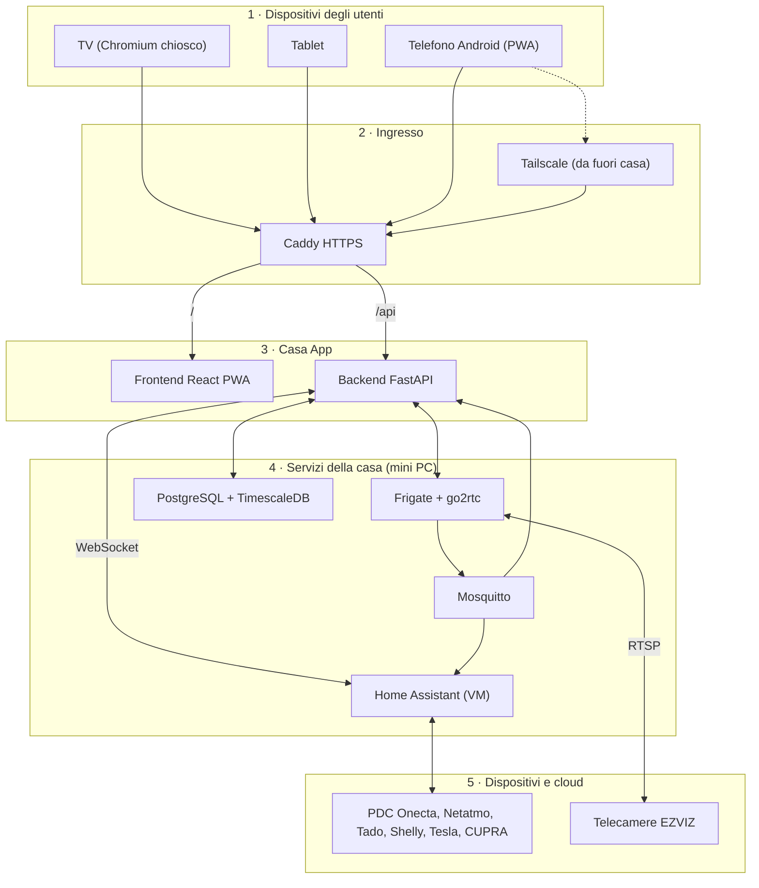

# Casa App – Documento di architettura

Nov 3, 2026 · @Roberto

## 1. Scopo e ambito

Casa App è l'interfaccia unica della casa di Casale Litta. Home Assistant (HA) è il motore nascosto. Gli utenti vedono solo Casa App.

**Casa App fa:**

- mostra lo stato di tutti i dispositivi in tempo reale;
- invia i comandi (setpoint, interruttori, scenari, modalità camino);
- mostra lo storico a lungo termine con grafici;
- mostra le telecamere in diretta e le clip registrate;
- funziona su TV, tablet, telefono Android e da fuori casa.

**Casa App non fa:**

- non comunica direttamente con i dispositivi o con i loro cloud: questo compito è di HA;
- non registra i video: questo compito è di Frigate;
- non contiene le logiche che comandano la PDC: queste logiche restano in HA (PDC Agent, modalità camino).

**Origine.** Casa App estende Casa Clima v15 (`casa-clima.html`) e la pagina 3D (`casa-3d-live.html`). Riusa le loro viste, la tabella delle entità `CFG` e i test con HA simulato. L'integrazione CUPRA resta un modulo separato.

**Utenti.** Due utenti adulti, più un account per la TV.

## 2. Requisiti

Casa App deve soddisfare 7 requisiti funzionali e 6 non funzionali. Ogni fase di sviluppo (sezione 12) si chiude solo quando i suoi requisiti sono verificati.

| ID | Requisito | Verifica |
| --- | --- | --- |
| RF-01 | Mostrare lo stato di tutte le entità in tempo reale | Ritardo < 2 s tra HA e app |
| RF-02 | Inviare comandi: setpoint, interruttori, scenari, modalità camino | Il comando arriva ad HA e lo stato torna all'app |
| RF-03 | Conservare lo storico a lungo termine | Grafico di 1 anno in < 1 s |
| RF-04 | Sostituire i log CSV separati con un unico log | Dati granulare, decadimento, timeline e shadow ML nello stesso database |
| RF-05 | Mostrare 5–8 telecamere in diretta e le clip su movimento | Clip conservate 30 giorni |
| RF-06 | Offrire le viste Casa, Impianto, Energia, Statistiche, 3D, Telecamere, Auto | Tutte le viste usabili su TV, tablet e telefono |
| RF-07 | Registrare chi invia ogni comando | Registro dei comandi con utente e ora |
| RNF-01 | Continuare a funzionare senza internet per le parti locali | Shelly, telecamere e storico attivi con la linea assente |
| RNF-02 | Permettere l'accesso da fuori casa senza porte aperte sul router | Accesso da rete mobile con Tailscale |
| RNF-03 | Supportare TV con tastiera e mouse wireless, tablet e telefono Android | Prova su ciascun dispositivo |
| RNF-04 | Permettere il ripristino completo da backup | Ripristino su disco vuoto in < 1 h |
| RNF-05 | Ridurre la manutenzione al minimo | Nessuna integrazione dei dispositivi scritta da zero |
| RNF-06 | Proteggere i dati e i comandi | Nessun token nel frontend; solo servizi HA autorizzati |

## 3. Architettura a livelli

Casa App ha cinque livelli. Ogni livello comunica solo con il livello adiacente.



> Il diagramma originale era un contenuto incorporato non esportabile: questo lo ricostruisce dal testo.

Il backend è l'unico punto che conosce i token e decide quali comandi passano. HA e Frigate restano nascosti agli utenti.

**Esempio di flusso: accensione della modalità camino**

1. L'utente preme il pulsante nell'app.
2. Il frontend invia `POST /api/command` al backend.
3. Il backend controlla il servizio nella lista autorizzata e chiama HA (`input_boolean.turn_on`).
4. HA esegue la logica della modalità camino e invia il comando al cloud Onecta.
5. La PDC cambia stato.
6. HA emette `state_changed`. Il backend aggiorna l'app e scrive lo storico.

## 4. Componenti e tecnologie

Tutti i componenti girano sul mini PC. HA gira in una macchina virtuale; gli altri componenti girano in container Docker. Le scelte del backend e del frontend sono modificabili prima della fase 3.

| Componente | Tecnologia | Funzione | Dove gira |
| --- | --- | --- | --- |
| Sistema operativo | Ubuntu Desktop LTS | Base del mini PC, uscita HDMI verso la TV | Mini PC |
| Virtualizzazione | KVM + libvirt (virt-manager) | Esegue la VM di HA, avvio automatico | Mini PC |
| Motore domotico | Home Assistant OS | Integrazioni, entità, logiche critiche, PDC Agent | VM: 2 vCPU, 4 GB RAM, 64 GB |
| Container | Docker + Docker Compose | Avvia e aggiorna tutti gli altri componenti | Mini PC |
| Broker messaggi | Mosquitto (MQTT) | Trasporta gli eventi di Frigate verso HA e il backend | Container |
| Registratore video | Frigate + go2rtc | Rilevamento persone/auto, clip, diretta WebRTC | Container, grafica Intel (OpenVINO) |
| Database | PostgreSQL + TimescaleDB | Storico a lungo termine, utenti, registro comandi | Container |
| Backend | Python 3.12 + FastAPI | Gateway verso HA e Frigate, API, autenticazione, scrittura storico | Container |
| Frontend | TypeScript + React + Vite (PWA) | Interfaccia per TV, tablet e telefono | Container (file statici) |
| Reverse proxy | Caddy | Unico ingresso HTTPS: `/` frontend, `/api` backend | Container |
| Accesso remoto | Tailscale | VPN privata, certificato HTTPS, nessuna porta aperta | Mini PC + telefoni |
| Schermo TV | Chromium in modalità chiosco | Apre Casa App a schermo intero all'avvio | Mini PC |

**Perché Python per il backend.** I componenti custom di HA (PDC Agent, Logger, Shadow ML) sono in Python. Un solo linguaggio lato server riduce la manutenzione.

**Perché TimescaleDB.** Un solo database SQL contiene serie temporali, utenti e registro comandi. Le aggregazioni automatiche rendono veloci i grafici di anni.

## 5. Interfaccia con Home Assistant

Solo il backend comunica con HA, tramite l'API WebSocket e un token di lunga durata. Il frontend comunica solo con il backend.

**Connessione backend → HA**

- Indirizzo: `ws://<ip-ha>:8123/api/websocket`.
- Token di lunga durata in `backend/.env`, mai nel repository e mai nel frontend.
- Messaggi usati: `auth`, `get_states`, `subscribe_events` (`state_changed`), `call_service`, `history/history_during_period`, `recorder/statistics_during_period`.
- Alla perdita della connessione il backend riprova con attesa crescente (1 s, 2 s, 4 s, max 60 s). Dopo la riconnessione rilegge `get_states`.

**Mappa delle entità.** Ogni `entity_id` compare solo in `config/entities.yaml`. Il codice usa nomi logici. Il file parte dalla tabella `CFG` di Casa Clima v15.

| Nome logico | Entità HA | Uso |
| --- | --- | --- |
| `pdc.target_pt` | `input_number.pdc_target_temp` | Target piano terra |
| `pdc.target_1p` | `input_number.pdc_hvac_night_target` | Target primo piano (boost notte canalizzato) |
| `pdc.offset` | `climate.pdc_leaving_water_offset` | Offset mandata (attributo temperature) |
| `pdc.potenza` | `sensor.2_pdc_channel_1_power` | Potenza elettrica PDC |
| `acs.stato` | `water_heater.pdc` | Acqua calda sanitaria |
| `zona_giorno.temp` | `sensor.zona_giorno_temperatura` | Netatmo zona giorno |
| `vmc.pt` / `vmc.1p` | `switch.shellyplus2pm_1c6920480994_switch_0` / `_1` | VMC piano terra / primo piano (da confermare) |
| `hvac.potenza` | `sensor.hvac_shelly_channel_1_power` | Potenza clima |

**Servizi autorizzati.** Il backend accetta solo i servizi in `config/services_allowlist.yaml`. Elenco iniziale: `input_boolean.turn_on/turn_off`, `input_number.set_value`, `climate.set_temperature`, `climate.set_hvac_mode`, `switch.turn_on/turn_off`, `water_heater.set_temperature`, `script.turn_on`.

**Dove stanno le logiche.**

- Logiche che comandano impianti (PDC Agent, modalità camino, Deep Sleep): in HA, come package YAML o componenti custom. Funzionano anche con il backend spento.
- Logiche di presentazione (calcoli per grafici, quote orarie delle ultime 24 ore, SCOP mostrato): nel backend.

**API backend → frontend**

| Metodo | Percorso | Funzione |
| --- | --- | --- |
| GET | `/api/state` | Stato completo all'apertura |
| WS | `/api/live` | Variazioni di stato in tempo reale |
| POST | `/api/command` | Comando `{azione, target, valore}`; esito e registrazione |
| GET | `/api/history` | Serie storica: entità, intervallo, risoluzione |
| GET | `/api/cameras` | Elenco telecamere e indirizzi della diretta |
| GET | `/api/events` | Eventi di movimento: telecamera, intervallo, oggetto |
| GET | `/api/clips/{id}` | Clip video di un evento |
| POST | `/api/login` | Accesso utente; sessione lunga sui dispositivi di casa |

## 6. Modello dati e storico

TimescaleDB è il log unico della casa e sostituisce i CSV separati. HA conserva solo 10 giorni di dati per il proprio uso.

**Scrittura.** Il backend legge gli eventi `state_changed` delle entità con `log: true` in `entities.yaml`. Per ogni entità scrive al massimo 1 valore ogni 10 s.

| Tabella | Contenuto | Conservazione |
| --- | --- | --- |
| `misure` | `ts`, `entita`, `valore_num`, `valore_testo`, `attributi` (JSON) | Dati grezzi 1 anno, compressi dopo 7 giorni |
| `misure_5min`, `misure_1h`, `misure_1g` | Media, minimo, massimo per entità (aggregazioni continue) | Senza scadenza |
| `comandi` | `ts`, `utente`, `servizio`, `target`, `valore`, `esito` | Senza scadenza |
| `eventi_video` | `ts`, `telecamera`, `oggetto`, `id_frigate`, `clip` | 30 giorni, come le clip |
| `utenti` | Nome, hash della password, ruolo, dispositivi | Senza scadenza |

**Importazione iniziale**

1. Uno script importa i CSV esistenti (`log_granulare`, `log_decadimento`, `log_timeline`, `log_shadow_ml`) nella tabella `misure`.
2. Uno script importa le statistiche a lungo termine di HA (`recorder/statistics_during_period`) per il periodo precedente.
3. Dopo l'importazione PDC Logger smette di scrivere i CSV. PDC Agent e Shadow ML restano in HA.

**Lettura.** L'API `/api/history` sceglie la tabella in base all'intervallo: grezzi fino a 2 giorni, 5 min fino a 30 giorni, 1 h fino a 1 anno, 1 g oltre.

## 7. Telecamere

Frigate registra le 5–8 EZVIZ solo su movimento di persone o auto e conserva le clip 30 giorni su un SSD dedicato da 2 TB.

**Flusso**

1. Ogni EZVIZ invia il flusso RTSP in rete locale.
2. go2rtc (incluso in Frigate) riceve il flusso una sola volta e lo ridistribuisce.
3. Frigate analizza il flusso secondario (circa 640×360, 5 fotogrammi/s) con la grafica Intel.
4. Frigate registra il flusso principale solo durante gli eventi.
5. Frigate pubblica gli eventi su MQTT. HA e il backend li ricevono.
6. Il frontend mostra la diretta via WebRTC, tramite il backend.

**Indirizzi RTSP (da verificare per ogni modello)**

- Principale: `rtsp://admin:<codice-verifica>@<ip>:554/h264/ch1/main/av_stream`
- Secondario: `rtsp://admin:<codice-verifica>@<ip>:554/h264/ch1/sub/av_stream`
- Il codice di verifica è sull'etichetta della telecamera. Va in `frigate/.env`, mai nel repository.

**Regole di registrazione**

- Oggetti rilevati: `person`, `car`.
- Registrazione continua: 0 giorni.
- Allarmi e rilevamenti: 30 giorni.
- Zone di esclusione per alberi e strada, da disegnare in Frigate per ogni telecamera.

**Disco.** Stima: 8 telecamere × 3 h/giorno × 3 Mbit/s ≈ 32 GB/giorno ≈ 1 TB in 30 giorni. Il disco da 2 TB dà un margine del 100%. Punto di montaggio: `/mnt/video`.

**Rete.** Ogni telecamera ha un indirizzo IP fisso (prenotazione DHCP sul router). L'app EZVIZ continua a funzionare in parallelo. Alcuni modelli limitano i flussi contemporanei: va verificato per ogni modello.

## 8. Frontend PWA

Un solo frontend serve TV, tablet e telefono. La disposizione cambia con la larghezza dello schermo.

| Dispositivo | Larghezza | Disposizione | Comando |
| --- | --- | --- | --- |
| TV (mini PC) | ≥ 1600 px | Pannello di supervisione + griglia telecamere 2×4 | Tastiera e mouse wireless, scorciatoie 1–7 per le viste |
| Tablet | 900–1600 px | Pannello di controllo (variante B di Casa Clima) | Tocco |
| Telefono Android | < 900 px | App con barra in basso (variante B3 di Casa Clima) | Tocco, PWA installata |

| Vista | Contenuto | Origine |
| --- | --- | --- |
| Casa | Sinottico: comfort, PDC, clima, VMC, comandi, modalità camino | Casa Clima v15 |
| Impianto | Schema idronico con flussi animati, PDC, ACS | Casa Clima v15 |
| Energia | Flussi FV, accumulo, rete, casa, auto | Casa Clima v15 (statistiche C) |
| Statistiche | Grafici storici, consumi, SCOP, ultime 24 ore | Nuova, da TimescaleDB |
| 3D | Esploso assonometrico con misure dal vivo | `casa-3d-live.html`, prima in iframe, poi integrata |
| Telecamere | Diretta, eventi del giorno, clip per telecamera e oggetto | Nuova, da Frigate |
| Auto | Tesla e CUPRA: carica, autonomia, stato | Nuova; CUPRA come modulo separato |

**Regole dell'interfaccia**

- Tema automatico chiaro o scuro.
- Ogni comando mostra lo stato "in invio" fino alla conferma di HA.
- Senza connessione l'app mostra l'ultimo stato noto e l'ora dell'ultimo dato.
- Testi dell'interfaccia in italiano.

## 9. Sicurezza e accesso remoto

Nessun servizio della casa è esposto su internet. L'accesso da fuori passa solo da Tailscale.

- **Accesso remoto:** Tailscale sul mini PC e sui telefoni. Nessuna porta aperta sul router. HA, Frigate e database non sono raggiungibili da internet.
- **HTTPS:** certificato di Tailscale (`*.ts.net`) per l'accesso remoto; Caddy per la rete di casa.
- **Utenti:** due account personali e un account TV. Sessione lunga sui dispositivi di casa; nuovo accesso dopo 30 giorni sui telefoni.
- **Segreti:** token HA, codici delle telecamere e password del database solo nei file `.env`. I file `.env` sono esclusi dal repository (`.gitignore`).
- **Comandi:** il backend accetta solo i servizi autorizzati (sezione 5) e registra ogni comando.
- **Aggiornamenti:** Ubuntu installa da solo gli aggiornamenti di sicurezza. HA e Frigate si aggiornano a mano, sempre dopo un backup.
- **Backup:** ogni notte backup di HA, dump del database e configurazione. Copia su un secondo dispositivo (Raspberry o NAS) e una copia fuori casa.

## 10. Hardware e installazione

Un mini PC da 300–600 € con grafica Intel, 16 GB di RAM e due slot per dischi esegue tutto. Il VPS è escluso: non ha uscita verso la TV, non ha spazio per i video e non vede la rete di casa.

| Elemento | Requisito minimo | Motivo |
| --- | --- | --- |
| CPU | Intel Core i5 12ª gen o superiore (minimo N305) | Decodifica e rilevamento di 8 telecamere |
| RAM | 16 GB | VM HA 4 GB, Frigate 2 GB, database 2 GB, desktop e Chromium 3 GB |
| Disco sistema | NVMe 512 GB | Sistema, VM, container, database |
| Disco video | SSD 2 TB nel secondo slot | Clip di 30 giorni con margine |
| Rete | Ethernet 2,5 Gbit/s, via cavo al router | 8 flussi video costanti |
| Video | HDMI 2.0, 4K | Uscita verso la TV |
| Continuità | Piccolo UPS per mini PC, router e switch | Nessun arresto per cali di tensione |

**Installazione**

1. Installare Ubuntu Desktop LTS sul disco NVMe.
2. Installare Docker, Docker Compose, KVM, libvirt e virt-manager.
3. Creare il ponte di rete `br0`: la VM di HA deve avere un proprio IP sulla rete di casa.
4. Creare la VM con l'immagine ufficiale HA OS (qcow2): 2 vCPU, 4 GB RAM, 64 GB. Attivare l'avvio automatico.
5. Fare un backup completo di HA sul Raspberry. Spegnere il Raspberry.
6. Assegnare alla VM l'IP del Raspberry (prenotazione DHCP). Ripristinare il backup nella VM.
7. Verificare entità, componenti custom e PDC Agent per 48 h. Conservare la SD del Raspberry per 2–4 settimane.
8. Montare l'SSD video su `/mnt/video`. Avviare i container: `docker compose up -d`.
9. Installare Tailscale. Configurare Chromium in modalità chiosco all'avvio.
10. Configurare i backup notturni e provare un ripristino.

**Attenzione:** non tenere mai accesi insieme il Raspberry e la VM. Le due istanze darebbero comandi in conflitto alla PDC e invaliderebbero i token dei cloud (Tesla, Tado, CUPRA).

## 11. Struttura del repository

Un solo repository Git contiene codice, configurazione e documentazione. I package YAML di HA sono nel repository e si copiano in `/config/packages/`.

```
casa-app/
├─ CLAUDE.md                 # regole per Claude Code (sezione 13)
├─ docker-compose.yml        # mosquitto, frigate, db, backend, frontend, caddy
├─ .env.example              # variabili richieste, senza valori
├─ config/
│  ├─ entities.yaml          # nomi logici → entity_id, flag log
│  └─ services_allowlist.yaml
├─ backend/                  # Python + FastAPI
│  ├─ app/
│  │  ├─ ha_client.py        # WebSocket HA, riconnessione
│  │  ├─ frigate_client.py   # API Frigate, MQTT
│  │  ├─ history.py          # scrittura e lettura TimescaleDB
│  │  ├─ api/                # state, live, command, history, cameras, auth
│  │  └─ auth.py
│  ├─ migrations/            # schema database
│  ├─ scripts/               # import CSV e statistiche HA
│  └─ tests/                 # pytest + HA simulato
├─ frontend/                 # TypeScript + React + Vite, PWA
│  ├─ src/views/             # casa, impianto, energia, statistiche, 3d, telecamere, auto
│  ├─ src/components/
│  └─ tests/                 # vitest + Playwright
├─ frigate/config.yml
├─ caddy/Caddyfile
├─ ha/packages/              # clima.yaml, modalita_camino.yaml
├─ ops/                      # backup, ripristino, chiosco TV
└─ docs/                     # questo documento in Markdown
```

## 12. Piano di sviluppo per fasi

Il piano ha 8 fasi in sequenza. Ogni fase parte solo quando la precedente supera il suo criterio di uscita.

| Fase | Contenuto | Criterio di uscita |
| --- | --- | --- |
| F0 – Base | Ubuntu, Docker, KVM, ponte di rete, SSD video | La VM vuota si riavvia da sola dopo un riavvio del mini PC |
| F1 – Migrazione HA | Backup del Raspberry, ripristino nella VM, stesso IP | Tutte le entità di Casa Clima v15 disponibili; PDC Agent senza errori per 48 h |
| F2 – Telecamere | Mosquitto, Frigate, zone di esclusione, integrazione HA | 5–8 telecamere in diretta; clip di persone e auto; CPU < 50% |
| F3 – Backend | Client HA, stato live, comandi autorizzati, API, autenticazione | Test automatici verdi con HA simulato e con HA reale |
| F4 – Storico | TimescaleDB, scrittura, aggregazioni, import CSV | Grafico di 1 anno in < 1 s; CSV importati senza perdite |
| F5 – Frontend | Viste Casa, Impianto, Statistiche; poi Energia, Telecamere, 3D, Auto | Uso quotidiano per 2 settimane su TV, tablet e telefono |
| F6 – Accesso remoto | Tailscale, HTTPS, utenti, sessioni | App funzionante da rete mobile; HA non raggiungibile da internet |
| F7 – Backup | Backup notturni, copia esterna, procedura di ripristino | Ripristino completo su disco vuoto in < 1 h |

## 13. Regole per Claude Code

Queste regole vanno copiate in `CLAUDE.md` nella radice del repository. Claude Code le legge a ogni sessione.

1. Leggi `docs/architettura.md` prima di ogni attività.
2. Non scrivere integrazioni dei dispositivi. Usa le entità di HA.
3. Non mettere nel backend logiche che comandano impianti. Scrivile come package YAML in `ha/packages/`.
4. Scrivi ogni `entity_id` solo in `config/entities.yaml`.
5. Aggiungi ogni nuovo servizio HA a `config/services_allowlist.yaml`.
6. Non scrivere token, password o codici nel codice o nel repository. Usa i file `.env`.
7. Scrivi un test per ogni funzione nuova. Usa HA simulato per i test del backend.
8. Fai commit piccoli: una funzione per commit.
9. Verifica che `docker compose up -d` parta senza errori prima di ogni commit.
10. Scrivi il codice e i commenti in inglese, i testi dell'interfaccia in italiano.
11. Scrivi la documentazione con frasi brevi in forma attiva (stile STE).

## 14. Punti aperti

- [ ] Marca e modello di inverter FV e accumulo (il modello 3D riporta un Powerwall: da confermare).
- [ ] Marca e modello della colonnina di ricarica.
- [ ] Marca e modello della VMC; conferma `switch_0` = piano terra e `switch_1` = primo piano.
- [ ] Modelli delle EZVIZ: percorso RTSP e numero di flussi contemporanei.
- [ ] Esistenza delle valvole `climate.*` delle singole stanze.
- [ ] Notifiche: quali eventi (persone di notte, allarmi PDC) e su quale canale.
- [ ] Rete separata (VLAN) per le telecamere: sì o no.
- [ ] Destinazione della copia di backup fuori casa.
- [ ] Modello del mini PC: scelta tra 2–3 proposte.
- [ ] Vista Auto: Tesla e CUPRA nella stessa vista o separate.
