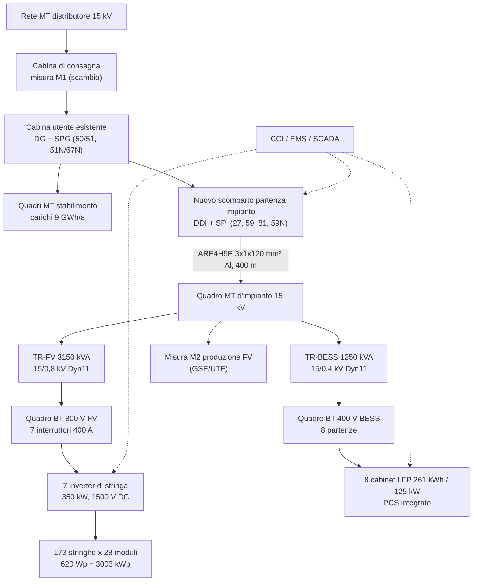

# Relazione tecnica di ingegneria di dettaglio – Impianto FV 3 MWp con BESS 2 MWh / 1 MW

## 0. Cartiglio

| Campo | Valore |
|---|---|
| Documento | FVB-ENG-001 |
| Titolo | Relazione tecnica di ingegneria di dettaglio – impianto fotovoltaico a terra con sistema di accumulo, stabilimento industriale (caso di riferimento A) |
| Revisione | A |
| Data | 27/10/2026 |
| Stato | Emesso per commenti – pre-FEED |
| Commessa | da compilare |
| Committente | da compilare |
| Redatto | da compilare |
| Verificato | da compilare |
| Approvato | da compilare |

| Rev. | Data | Descrizione | Redatto | Verificato | Approvato |
|---|---|---|---|---|---|
| A | 27/10/2026 | Prima emissione per commenti | – | – | – |

> **Avvertenza.** Quantità, tensioni, correnti, sezioni e prestazioni di questa relazione vengono dal simulatore FV+BESS (`js/engine.js`, funzione `engineering`; risultati in `docs/allegati/A1_Risultati_casi.md`, sezioni 6 e 10) o da calcoli preliminari riportati con formula e dati. Il meteo è sintetico, ricavato da medie mensili, e i componenti sono modelli tipo. Il documento serve alla pre-fattibilità e alla definizione dello scopo. Prima di usarlo in un progetto autorizzativo o esecutivo va validato da un ingegnere abilitato, con dati di sito (PVGIS/TMY, rilievo, indagini geotecniche), schede tecniche dei fornitori scelti e regolamento di esercizio del distributore. I punti segnati **[da verificare]** richiedono un controllo specifico.

---

## 1. Scopo e campo di applicazione

La relazione descrive le scelte progettuali, i criteri di dimensionamento e le verifiche preliminari di un impianto fotovoltaico a terra con struttura fissa da circa **3,0 MWp DC / 2,45 MWac**, abbinato a un sistema di accumulo elettrochimico (BESS) agli ioni di litio LFP da **2 MWh / 1 MW**. L'impianto è installato in un'area di pertinenza di uno stabilimento manifatturiero in provincia di Milano e funziona in **autoconsumo**: è collegato alla cabina utente MT esistente a 15 kV, a valle del punto di consegna del distributore.

La relazione copre:

- il generatore fotovoltaico, la conversione DC/AC e la trasformazione BT/MT;
- il sistema di accumulo (architettura, sicurezza, logiche di controllo);
- l'interfaccia con la rete e con la cabina utente (protezioni CEI 0-16, controllore centrale d'impianto);
- impianto di terra, protezione dai fulmini, opere civili e strutturali, monitoraggio;
- prevenzione incendi, iter autorizzativo, collaudi, manutenzione, elenco elaborati, rischi.

Non copre il progetto esecutivo strutturale, la relazione geologica, il progetto della rete del distributore né l'analisi economica, per cui si rimanda a `02_Analisi_Economica.md` e `04_Valutazione_CAPEX.md`.

---

## 2. Basi di progetto

### 2.1 Dati di sito

| Grandezza | Valore | Fonte / nota |
|---|---|---|
| Località | Milano (Lombardia), area industriale | caso A del simulatore |
| Coordinate di calcolo | 45,46° N; 9,19° E | `js/data.js` (SITES.milano) |
| Quota | circa 120 m s.l.m. | [da verificare] sul rilievo |
| Zona di mercato | NORD | |
| Irraggiamento globale orizzontale | 1.320 kWh/m²·a circa (media mensile da 1,10 a 6,45 kWh/m²·giorno) | atlante; per l'esecutivo usare PVGIS-SARAH TMY |
| Irraggiamento sul piano dei moduli (incl. retro bifacciale) | 1.519 kWh/m²·a | simulatore |
| Superficie disponibile richiesta | 3,58 ha (moduli 13.085 m², GCR 0,42, +15 % viabilità e fasce) | A1 § 10 |
| Zona sismica | 4 (bassa sismicità) | [da verificare] sulla classificazione regionale vigente |
| Zona vento NTC 2018 | 1 (vb,0 = 25 m/s) | § 10.2 |
| Zona neve NTC 2018 | I-Mediterranea (qsk = 1,50 kN/m² per as ≤ 200 m) | § 10.2 |

### 2.2 Dati climatici di progetto

| Grandezza | Valore | Criterio |
|---|---|---|
| Temperatura media mensile minima | 2,5 °C (gennaio) | dati di sito |
| Temperatura media mensile massima | 24,0 °C (luglio) | dati di sito |
| **Temperatura minima di progetto** | **−9,5 °C** | media mensile minima − 12 °C (criterio del simulatore per la Voc) |
| **Temperatura ambiente massima di progetto** | **36,0 °C** | media mensile massima + 12 °C |
| **Temperatura di cella massima** | **64,8 °C** | Tamb,max + (NOCT − 20) × 1,25 = 36 + 23 × 1,25 |
| Albedo del terreno | 0,20 | prato; valore da misurare per la resa bifacciale |

La temperatura minima di progetto va confermata con la serie storica della stazione meteo più vicina (minima assoluta con tempo di ritorno adeguato) **[da verificare]**: a parità di modulo stabilisce il numero massimo di moduli in serie.

### 2.3 Dati di carico dello stabilimento

| Grandezza | Valore |
|---|---|
| Consumo annuo | 9.000 MWh/a |
| Organizzazione | 2 turni (6–22, lunedì–venerdì), sabato ridotto, fermata estiva di 2 settimane e natalizia |
| Picco di prelievo annuo senza impianto | 2.209 kW |
| Picco di prelievo annuo con impianto (caso A) | 2.096 kW |
| Potenza disponibile in prelievo | 4.000 kW |
| Potenza in immissione richiesta | 3.000 kW |

Il profilo di carico del simulatore è sintetico. Per il progetto definitivo si deve acquisire la curva quartoraria misurata (almeno 12 mesi) dal distributore o dal contatore fiscale.

### 2.4 Dati di rete

| Grandezza | Valore | Nota |
|---|---|---|
| Tensione nominale di consegna | 15 kV, 50 Hz | cabina utente esistente |
| Stato del neutro MT | compensato (bobina di Petersen) o isolato | [da verificare] col distributore |
| Corrente di cortocircuito trifase di rete | 12,5 kA (valore di progetto tipico per le reti MT a 15 kV) | [da verificare] nel regolamento di esercizio |
| Corrente di guasto a terra | secondo dati del distributore | [da verificare] |
| Tempo di eliminazione del guasto a terra | secondo dati del distributore | per il dimensionamento dell'impianto di terra (CEI EN 50522) |

### 2.5 Vita utile e criteri generali

| Grandezza | Valore |
|---|---|
| Vita utile di progetto dell'impianto FV | 25 anni (moduli con garanzia di prestazione a 30 anni) |
| Vita utile BESS | 25 anni con una augmentation (anno 15 nel caso A) |
| Sostituzione inverter | prevista all'anno 13 |
| Disponibilità di progetto | 99 % |
| Codici e unità | Sistema SI, norme CEI/EN/IEC (§ 3) |

---

## 3. Normativa di riferimento

Le edizioni vanno verificate alla data di emissione del progetto esecutivo. Dove l'edizione o l'esistenza del documento non è certa è indicato **[da verificare l'edizione vigente]**.

### 3.1 Connessione e impianti elettrici

| Norma | Oggetto |
|---|---|
| CEI 0-16 (ed. vigente, con varianti) | Regola tecnica di connessione degli utenti attivi e passivi alle reti AT e MT; allegati su sistemi di accumulo, sistema di protezione di interfaccia (SPI), prove dei convertitori e controllore centrale d'impianto (CCI) [da verificare l'edizione vigente e la numerazione degli allegati] |
| CEI 82-25 | Guida alla realizzazione di sistemi di generazione fotovoltaica collegati alle reti MT e BT [da verificare l'edizione vigente] |
| CEI 64-8 (in particolare sezione 712) | Impianti elettrici utilizzatori a tensione nominale ≤ 1.000 V c.a. e 1.500 V c.c. |
| IEC 60364-7-712 | Requisiti per gli impianti FV |
| CEI EN IEC 62548-1 | Requisiti di progetto dei campi fotovoltaici [da verificare l'edizione vigente] |
| CEI EN IEC 62446-1 | Prove, documentazione e manutenzione dei sistemi FV connessi alla rete |
| CEI EN 61936-1 / CEI EN 50522 | Impianti con tensione > 1 kV c.a.; messa a terra degli impianti > 1 kV |
| CEI EN 62305 (parti 1–4) | Protezione contro i fulmini |
| CEI EN 61643-31 / -32 | Limitatori di sovratensione (SPD) lato DC fotovoltaico |
| CEI EN 60076 (serie) | Trasformatori di potenza |
| Reg. UE 548/2014 e Reg. UE 2019/1783 | Ecodesign dei trasformatori (livello Tier 2) |
| Reg. UE 2016/631 (RfG) | Requisiti di connessione dei generatori |
| CEI EN 50618 | Cavi per impianti FV (H1Z2Z2-K) |
| CEI 20-13 / CEI UNEL 35024 e 35026 | Cavi MT e BT e relative portate |
| CEI 11-17 | Linee in cavo |

### 3.2 Sistemi di accumulo

| Norma | Oggetto |
|---|---|
| IEC 62933 (serie, parti 1, 2-1, 4-1, 5-1, 5-2) | Sistemi di accumulo di energia elettrica: terminologia, prestazioni, ambiente, sicurezza |
| CEI EN IEC 62619 | Requisiti di sicurezza per accumulatori al litio per applicazioni industriali |
| CEI EN IEC 62477-1 | Sicurezza dei convertitori elettronici di potenza |
| CEI EN IEC 62485-5 [da verificare l'edizione vigente] | Installazione sicura di batterie stazionarie al litio |
| UL 9540 / UL 9540A | Sistemi ESS; metodo di prova per la propagazione termica (riferimento internazionale) |
| NFPA 855 | Installazione di sistemi di accumulo stazionari (riferimento internazionale, non cogente in Italia) |
| Reg. UE 2023/1542 | Batterie e rifiuti di batterie (dichiarazione dell'impronta di carbonio, passaporto della batteria, due diligence, fine vita) |

### 3.3 Strutture, sicurezza, prevenzione incendi, autorizzazioni

| Norma | Oggetto |
|---|---|
| DM 17/01/2018 (NTC 2018) e Circolare 21/01/2019 n. 7 | Norme tecniche per le costruzioni e istruzioni applicative |
| DM 37/2008 | Installazione degli impianti all'interno degli edifici (per le parti applicabili) |
| DLgs 81/2008 | Sicurezza nei luoghi di lavoro e nei cantieri (Titolo IV) |
| DPR 151/2011 | Attività soggette ai controlli di prevenzione incendi |
| DM 03/08/2015 e s.m.i. (Codice di prevenzione incendi) | Metodologia di valutazione del rischio incendio |
| Guida VVF per l'installazione degli impianti FV (nota DCPREV prot. 1324 del 07/02/2012) e chiarimenti successivi | Prevenzione incendi per impianti FV [da verificare eventuali aggiornamenti] |
| Indicazioni/linee guida del CNVVF per i sistemi BESS | [da verificare se è stato emanato un documento ufficiale e la sua data; in assenza si applica la valutazione del rischio secondo il Codice di prevenzione incendi] |
| DLgs 190/2024 (Testo unico FER) e s.m.i. | Regimi amministrativi per gli impianti a fonti rinnovabili; aree idonee |
| Delibere ARERA (TICA, TIDE, TIS) | Connessione, dispacciamento, settlement |

---

## 4. Descrizione generale dell'impianto

L'impianto ha tre sottosistemi:

1. **Generatore FV**: 4.844 moduli TOPCon bifacciali da 620 Wp in 173 stringhe da 28 moduli, montati su strutture fisse a 25° con orientamento sud. Potenza DC effettiva 3.003,3 kWp.
2. **Conversione e trasformazione FV**: 7 inverter di stringa da 350 kW / 1.500 V DC / 800 V AC (2.450 kWac, rapporto DC/AC 1,23) collegati a un quadro BT 800 V nella cabina di trasformazione, con un trasformatore da 3.150 kVA 15/0,8 kV Dyn11.
3. **Sistema di accumulo (AC-coupled)**: 8 cabinet LFP da 261 kWh / 125 kW con PCS integrato (2.088 kWh installati, 1.000 kW), quadro BT di parallelo e trasformatore dedicato da 1.250 kVA, collegati al quadro MT d'impianto.

Il quadro MT d'impianto è collegato con una linea in cavo da 400 m (ARE4H5E 12/20 kV, 3 × 1 × 120 mm² Al) a uno scomparto partenza da realizzare nella cabina utente esistente, a valle del dispositivo generale (DG) e della misura fiscale del distributore. Il sistema di protezione di interfaccia (SPI) agisce sul dispositivo di interfaccia (DDI) a monte di FV e BESS. Il controllore centrale d'impianto (CCI) gestisce la limitazione dell'immissione e la regolazione di potenza attiva e reattiva.

### 4.1 Schema unifilare semplificato

### 4.2 Dati principali

| Grandezza | Valore |
|---|---|
| Potenza DC installata | 3.003,3 kWp |
| Potenza AC nominale inverter | 2.450 kW |
| Rapporto DC/AC | 1,23 |
| Producibilità specifica anno 1 | 1.310 kWh/kWp |
| Produzione anno 1 (al punto di consegna) | 3.931 MWh |
| Performance ratio (anno 1) | 86,3 % |
| Energia BESS installata / utile | 2.088 kWh / 1.800 kWh (DoD 90 % su 2.000 kWh nominali) |
| Potenza BESS | 1.000 kW (C-rate 0,5, durata 2 h) |
| Autoconsumo della produzione FV | 86 % |
| Copertura dei consumi (autosufficienza) | 40 % |
| CO₂ evitata | circa 832 t/a (fattore 0,25 t/MWh) |

---

## 5. Generatore fotovoltaico

### 5.1 Moduli

| Parametro | Simbolo | Valore |
|---|---|---|
| Tecnologia | – | TOPCon n-type, bifacciale vetro-vetro |
| Potenza nominale STC | Pmax | 620 Wp |
| Tensione a vuoto | Voc | 48,9 V |
| Tensione MPP | Vmp | 41,0 V |
| Corrente di cortocircuito | Isc | 16,0 A |
| Corrente MPP | Imp | 15,12 A |
| Coefficiente di temperatura Voc | βVoc | −0,25 %/°C |
| Coefficiente di temperatura Vmp | βVmp | −0,29 %/°C |
| Coefficiente di temperatura Pmax | γ | −0,29 %/°C |
| Coefficiente di temperatura Isc | α | +0,045 %/°C |
| NOCT | – | 43 °C |
| Bifaccialità | – | 80 % |
| Dimensioni | – | 2.382 × 1.134 mm (2,70 m²) |
| Massa | – | 33,0 kg (12,2 kg/m²) |
| Tensione massima di sistema | – | 1.500 V DC |
| Certificazioni richieste | – | IEC 61215, IEC 61730, classe di reazione al fuoco secondo la guida VVF; iscrizione al registro ENEA (categorie B/C se si usa l'iper-ammortamento, vedi `03_Contributi_Incentivi_UE_IT.md`) |

I valori sono quelli del modulo tipo del simulatore. Vanno sostituiti con la scheda tecnica del fornitore scelto, e il dimensionamento delle stringhe va ripetuto.

### 5.2 Strutture e layout

| Grandezza | Valore | Note |
|---|---|---|
| Tipo | Struttura fissa monopalo/bipalo in acciaio zincato, 2 moduli in verticale (2P) | |
| Inclinazione / azimut | 25° / 0° (sud) | ottimo economico con GCR 0,42 |
| Profondità del tavolo (2P) | 2 × 2,382 + 0,02 = 4,78 m | |
| GCR | 0,42 | |
| Interasse tra le file (pitch) | 4,78 / 0,42 = 11,4 m | |
| Proiezione orizzontale del tavolo | 4,78 × cos 25° = 4,34 m | |
| Dislivello tra bordo inferiore e superiore | 4,78 × sin 25° = 2,02 m | |
| Tavolo tipo | 2P × 28 = 56 moduli = 2 stringhe | 86 tavoli da 56 moduli + 1 tavolo da 28 moduli |
| Altezza minima del bordo inferiore dal suolo | ≥ 0,8 m | per la resa bifacciale, la manutenzione del verde e il deflusso della neve |

**Verifica di ombreggiamento tra le file (solstizio d'inverno, mezzogiorno solare).** Elevazione solare: h = 90° − 45,46° − 23,45° = 21,1°. Lunghezza dell'ombra del bordo superiore: 2,02 / tan 21,1° = 5,24 m. Distanza libera tra le file: 11,4 − 4,34 = 7,06 m > 5,24 m. A mezzogiorno del 21 dicembre non c'è ombreggiamento reciproco. Nelle prime e ultime ore delle giornate invernali resta una perdita, compresa nell'1,5 % di ombreggiamento della tabella perdite. Verifica preliminare da ripetere con il layout reale (PVsyst o equivalente).

### 5.3 Dimensionamento delle stringhe

Formule (convenzioni del simulatore, `engineering()`):

- Voc alla temperatura minima: Voc(Tmin) = Voc × [1 + βVoc/100 × (Tmin − 25)]
- Vmp alla temperatura minima: Vmp(Tmin) = Vmp × [1 + βVmp/100 × (Tmin − 25)]
- Vmp alla temperatura di cella massima: Vmp(Tc,max) = Vmp × [1 + βVmp/100 × (Tc,max − 25)]
- Moduli in serie massimi: Nmax = min[ floor(Vdc,max / Voc(Tmin)) ; floor(VMPPT,max / Vmp(Tmin)) ]
- Moduli in serie minimi: Nmin = ceil(VMPPT,min / Vmp(Tc,max)); a piena potenza Nmin,full = ceil(VMPPT,full,min / Vmp(Tc,max))

| Grandezza | Valore |
|---|---|
| Voc(−9,5 °C) | 48,9 × [1 − 0,0025 × (−34,5)] = **53,12 V** |
| Vmp(−9,5 °C) | 41,0 × [1 − 0,0029 × (−34,5)] = **45,10 V** |
| Vmp(64,8 °C) | 41,0 × [1 − 0,0029 × 39,75] = **36,27 V** |
| Nmax per tensione DC (1.500 / 53,12) | 28 |
| Nmax per finestra MPPT (1.500 / 45,10) | 33 |
| Nmin per MPPT (500 / 36,27) | 14 |
| Nmin a piena potenza (880 / 36,27) | 25 |
| **Moduli in serie scelti** | **28** |
| Potenza di stringa | 28 × 620 = 17,36 kWp |
| Numero di stringhe | 173 |
| Stringhe per inverter / per MPPT | 25 / 3 (inverter con 12 MPPT) |

Distribuzione: 173 stringhe su 7 inverter, cioè 5 inverter da 25 stringhe e 2 da 24. La distribuzione definitiva va bilanciata sugli MPPT in funzione del layout.

### 5.4 Verifiche elettriche

| Rif. | Verifica | Valore | Limite | Esito |
|---|---|---|---|---|
| S1 | Tensione a vuoto alla Tmin ≤ Vdc max inverter | 28 × 53,12 = 1.487 V | ≤ 1.500 V | verificato |
| S2 | Vmp alla Tmin ≤ limite superiore MPPT | 28 × 45,10 = 1.263 V | ≤ 1.500 V | verificato |
| S3 | Vmp alla Tcella max ≥ limite inferiore MPPT a piena potenza | 28 × 36,27 = 1.016 V | ≥ 880 V | verificato |
| S4 | Corrente di lavoro per MPPT | 3 × 15,12 = 45,4 A | ≤ 65 A | verificato |
| S5 | Corrente di cortocircuito per MPPT (× 1,25, a Tmax) | 3 × 16,0 × 1,25 × 1,018 = 61,1 A | ≤ 115 A | verificato |
| S6 | Stringhe per inverter entro gli ingressi disponibili | 25 | ≤ 36 | verificato |
| S7 | Rapporto DC/AC effettivo | 3.003 / 2.450 = 1,23 | 1,00 – 1,40 | verificato |

La verifica S1 ha un margine di soli 13 V (0,9 %), quindi la temperatura minima di progetto è il parametro critico. Se la minima assoluta di sito risultasse inferiore a −10 °C, o se il modulo scelto avesse una Voc più alta, si passa a 27 moduli in serie (Voc = 1.434 V; Vmp a caldo = 979 V ≥ 880 V, ancora verificato). In questo caso il numero di stringhe sale a circa 179.

### 5.5 Producibilità e perdite

Modello del simulatore: meteo orario sintetico (giornate generate con indice di serenità AR(1) e conservazione della media mensile), scomposizione diretta/diffusa di Erbs, trasposizione di Hay-Davies, guadagno bifacciale semplificato, temperatura di cella da NOCT, efficienza dell'inverter a carico parziale e clipping al limite AC.

| Perdita / fattore | Valore | Note |
|---|---|---|
| Sporcamento | 2,0 % | pulizia 2 volte/anno |
| Ombreggiamento (reciproco e ostacoli) | 1,5 % | da verificare col layout |
| Mismatch | 1,0 % | |
| Cavi DC | 1,2 % | a potenza nominale ΔV 0,66 %; valore energetico cautelativo |
| Bassa irradianza | 1,0 % (parametro) | |
| Temperatura | calcolata ora per ora | γ = −0,29 %/°C |
| Efficienza inverter | max 98,8 %, curva a carico parziale | |
| Clipping (DC/AC 1,23) | calcolato ora per ora | |
| Cavi AC | 0,8 % | |
| Trasformatore | 1,0 % | |
| Disponibilità | 99,0 % | |
| Degrado primo anno (incl. LID/LeTID) | 1,0 % | |
| Degrado annuo successivo | 0,40 %/anno | garanzia lineare tipica TOPCon |

| Indicatore (anno 1) | Valore |
|---|---|
| Irraggiamento sul piano dei moduli (incl. retro) | 1.519 kWh/m² |
| Producibilità specifica | 1.310 kWh/kWp |
| Performance ratio | 86,3 % |
| Produzione netta al punto di consegna | 3.931 MWh |

**Produzione e consumi mensili (anno 1, MWh).**

| Mese | Produzione FV | Consumo | FV autoconsumato diretto | Immissione | Scarica BESS |
|---|---:|---:|---:|---:|---:|
| Gen | 154 | 635 | 126 | 12 | 40 |
| Feb | 226 | 687 | 196 | 14 | 43 |
| Mar | 359 | 799 | 301 | 38 | 36 |
| Apr | 400 | 773 | 327 | 52 | 18 |
| Mag | 468 | 816 | 376 | 64 | 24 |
| Giu | 475 | 830 | 382 | 72 | 18 |
| Lug | 512 | 877 | 416 | 72 | 21 |
| Ago | 445 | 600 | 267 | 138 | 34 |
| Set | 364 | 830 | 306 | 42 | 40 |
| Ott | 257 | 788 | 216 | 22 | 48 |
| Nov | 146 | 746 | 130 | 5 | 43 |
| Dic | 125 | 619 | 107 | 4 | 38 |
| **Anno** | **3.931** | **9.000** | **3.152** | **535** | **405** |

La scarica BESS comprende l'energia caricata dal FV (244 MWh/a) e quella caricata da rete per arbitraggio (227 MWh/a). Ad agosto la fermata produttiva fa salire l'immissione. Il PR dell'86 % comprende il guadagno bifacciale. Per un modulo monofacciale nelle stesse condizioni il valore atteso è di circa 82–84 %.

**Nota sul modello.** Il simulatore è tarato per la pre-fattibilità. La producibilità di progetto (P50 e P90) va ricalcolata con PVsyst o un software equivalente, con dati TMY PVGIS-SARAH3 o Solargis del sito, orizzonte reale, layout 3D e scheda del modulo (file PAN) e dell'inverter (file OND).

---

## 6. Conversione DC/AC

### 6.1 Inverter

| Parametro | Valore |
|---|---|
| Tipo | Inverter di stringa trifase senza trasformatore |
| Potenza nominale AC | 350 kW (cos φ = 1) |
| Tensione DC massima | 1.500 V |
| Finestra MPPT / a piena potenza | 500–1.500 V / 880–1.300 V |
| Numero di MPPT / stringhe per MPPT | 12 / 3 |
| Corrente massima per MPPT (lavoro / cortocircuito) | 65 A / 115 A |
| Tensione AC di uscita | 800 V, 3 fasi senza neutro |
| Rendimento massimo | 98,8 % |
| Grado di protezione | IP66, installazione all'aperto sotto le strutture |
| Funzioni di rete | P/Q su comando del CCI, curva Q(V), limitazione P(f), LVFRT/HVFRT secondo CEI 0-16 |
| Numero | 7 (2.450 kWac) |

Gli inverter sono distribuiti nel campo, vicino ai baricentri dei sottocampi, per contenere la lunghezza dei cavi di stringa (lunghezza media di calcolo 70 m). Ogni inverter alimenta, con una propria linea in cavo, il quadro BT 800 V nella cabina di trasformazione FV.

### 6.2 Quadri di campo e protezioni DC

Con inverter di stringa a 12 MPPT e 3 stringhe per MPPT non servono quadri di parallelo stringhe (string box): le stringhe entrano direttamente nell'inverter. L'inverter deve integrare:

- **sezionatore DC sotto carico** per ogni MPPT (IEC 60947-3, categoria DC-PV2);
- **fusibili di stringa gPV 1.500 V** su entrambe le polarità. Con 3 stringhe in parallelo la corrente inversa massima su una stringa guasta è (Np − 1) × 1,25 × Isc = 2 × 1,25 × 16 = 40 A. Se il modulo ammette una corrente inversa massima (fusibile massimo in serie) inferiore, la protezione è obbligatoria (IEC 62548-1). Taglia proposta: 1,5 × Isc ≤ In ≤ 2,4 × Isc, cioè **25 A gPV** [da confermare con la scheda del modulo];
- **SPD DC tipo 2** (CEI EN 61643-31), con Ucpv ≥ 1,2 × Voc,STC del campo = 1,2 × 28 × 48,9 = 1.643 V, quindi ≥ Voc(Tmin) = 1.487 V. Prodotto da scegliere a 1.500 V DC con il criterio della norma di prodotto [da verificare]. Se la distanza tra campo e inverter supera 10 m, servono SPD anche lato moduli;
- **monitoraggio d'isolamento** (IMD) e protezione differenziale residua lato DC integrati nell'inverter (IEC 62109-2).

### 6.3 Cavi DC di stringa

Cavo solare **H1Z2Z2-K 1,5 kV DC** (CEI EN 50618), rame stagnato, posa in canalina sotto i moduli e in cavidotto interrato fino all'inverter.

Caduta di tensione: ΔV% = 2 × L × Imp × ρ / (S × Vstringa) × 100, con ρCu(70 °C) = 0,0216 Ω·mm²/m e Vstringa = 28 × 41,0 = 1.148 V.

| Grandezza | Valore |
|---|---|
| Lunghezza media (andata) | 70 m |
| Corrente | 15,12 A |
| **Sezione scelta** | **6 mm²** |
| ΔV a potenza nominale | 2 × 70 × 15,12 × 0,0216 / (6 × 1.148) = **0,66 %** (limite di progetto 1 %) |
| Portata del cavo 6 mm² in aria a 60 °C (riferimento) | circa 50 A (dato tipico del costruttore) [da verificare con fattori di posa e raggruppamento] |
| Corrente di progetto (1,25 × Isc) | 20 A: verificato con ampio margine |

Le stringhe più lontane dall'inverter (oltre circa 100 m) vanno verificate singolarmente, eventualmente con 10 mm².

### 6.4 Cavi AC BT 800 V (inverter – quadro BT)

Corrente nominale: I = P / (√3 × V) = 350.000 / (√3 × 800) = **252,6 A**.

Cavo **ARG16R16 / ARE4R 0,6/1 kV**, alluminio, unipolare, posa interrata in cavidotto.

| Grandezza | Valore |
|---|---|
| Lunghezza media | 150 m |
| **Sezione scelta** | **1 × (3 × 1 × 240 mm²) Al** |
| Portata di riferimento Iz | 345 A |
| Portata ridotta (coefficiente complessivo 0,8 per posa e raggruppamento) | 276 A ≥ 252,6 A: verificato |
| ΔV = √3 × L × I × ρAl / (S × V) × 100, ρAl(70 °C) = 0,0345 Ω·mm²/m | √3 × 150 × 252,6 × 0,0345 / (240 × 800) × 100 = **1,18 %** |
| Conduttore di protezione PE | ≥ S/2 per S > 35 mm² (CEI 64-8, tab. 54F) → 120 mm² Al o 70 mm² Cu [verifica preliminare: va controllata l'energia specifica passante I²t con la protezione scelta] |
| Protezione in partenza dal quadro BT | interruttore scatolato 400 A, 800 V AC, sganciatore elettronico LSI |

Il coefficiente di riduzione 0,8 è un valore cautelativo di pre-dimensionamento. In progetto esecutivo vanno applicati i coefficienti CEI UNEL 35026 per temperatura e resistività del terreno, profondità di posa e numero di circuiti nello stesso scavo: con 7 circuiti affiancati il coefficiente di raggruppamento può scendere sotto 0,7, nel qual caso si passa a 300 mm² o a cavidotti separati **[verifica preliminare]**.

### 6.5 Cadute di tensione complessive

| Tratto | ΔV a potenza nominale |
|---|---|
| Stringa – inverter (DC) | 0,66 % |
| Inverter – quadro BT (AC) | 1,18 % |
| Linea MT 15 kV, 400 m (§ 7.3) | 0,32 % |
| **Totale cavi** | **≈ 2,2 %** a piena potenza (perdita energetica annua inferiore, perché cresce col quadrato della corrente) |

---

## 7. Cabina di trasformazione e media tensione

### 7.1 Trasformatore FV

Potenza richiesta: S = Pac × 1,05 / 0,95 = 2.450 × 1,05 / 0,95 = 2.708 kVA. Si sceglie la taglia normalizzata superiore.

| Parametro | Valore |
|---|---|
| Potenza nominale | **3.150 kVA** |
| Rapporto | 15 kV ± 2 × 2,5 % / 0,8 kV |
| Gruppo vettoriale | Dyn11 (secondario con neutro non distribuito, verso gli inverter IT o TN secondo il costruttore) [da verificare con il costruttore dell'inverter] |
| Tensione di cortocircuito | 6–7 % (ipotesi di calcolo 6 %) |
| Isolamento | olio vegetale/estere naturale (K-class, punto di fuoco > 300 °C) oppure resina (secco) |
| Perdite | conformi al Reg. UE 548/2014 come modificato dal Reg. 2019/1783, livello Tier 2 (ordine di grandezza per 3.150 kVA in liquido: P0 ≈ 2,2 kW; Pk ≈ 23 kW) [valori indicativi: da verificare nella Tabella I.1 del regolamento e nelle esenzioni per i trasformatori elevatori di impianti FV] |
| Raffreddamento | ONAN |

La scelta tra olio estere e secco dipende dalla prevenzione incendi (§ 12). Un trasformatore in liquido isolante combustibile oltre 1 m³ rientra tra le attività soggette. Un 3.150 kVA in olio contiene di norma più di 1 m³ di liquido.

### 7.2 Quadro MT d'impianto

Quadro MT 24 kV, 16 kA × 1 s (o 20 kA, in base alla corrente di cortocircuito di rete), isolato in aria o in SF₆-free, con:

| Scomparto | Apparecchiatura |
|---|---|
| Arrivo linea dalla cabina utente | sezionatore sotto carico con sezionatore di terra |
| Misura | TV fase-fase, TV omopolare (per 59N), contatore M2 di produzione (se richiesto dal GSE) |
| Partenza TR-FV | interruttore in vuoto con protezione 50/51/51N del trasformatore |
| Partenza TR-BESS | interruttore in vuoto con protezione 50/51/51N |
| Servizi ausiliari | trasformatore MT/BT 25–50 kVA o derivazione BT dalla cabina utente, UPS 3 kVA, 2 h |

### 7.3 Linea MT verso la cabina utente

Corrente con FV e BESS in immissione contemporanea alla potenza nominale: I = (2.450 + 1.000) kW / (√3 × 15 kV × 0,95) = **139,8 A**.

| Grandezza | Valore |
|---|---|
| Cavo | ARE4H5E 12/20 kV, 3 × 1 × **120 mm²** Al, interrato in tubo (la portata richiederebbe 70 mm²; la sezione è fissata dalla tenuta al cortocircuito) |
| Lunghezza | 400 m |
| Portata Iz (riferimento) / ridotta × 0,8 | 200 A / 160 A ≥ 139,8 A: verificato |
| ΔV | √3 × 400 × 139,8 × 0,0345 / (70 × 15.000) × 100 = **0,32 %** (limite di progetto 0,5 %) |
| Tenuta al cortocircuito | Sezione minima S ≥ Icc × √t / K = 12.500 × √0,5 / 92 ≈ 96 mm² (K = 92 per Al/XLPE, Icc di rete 12,5 kA, eliminazione del guasto in 0,5 s) → **120 mm²**. Con 70 mm² la tenuta sarebbe solo 9,1 kA per 0,5 s [verifica preliminare: Icc e tempi da confermare con il distributore e il calcolo di selettività] |
| Schermo | da dimensionare sulla corrente di guasto a terra del distributore |

### 7.4 Correnti di cortocircuito (stima preliminare)

| Punto | Contributo | Calcolo | Valore |
|---|---|---|---|
| Sbarre MT 15 kV | Rete | dato del distributore | 12,5 kA [da verificare] |
| Sbarre MT 15 kV | Inverter FV + PCS BESS | 1,2 × In (simulatore) | 159 A |
| Sbarre BT 800 V FV | Rete tramite TR 3.150 kVA, ucc 6 % | In,BT = 3.150 / (√3 × 0,8) = 2.273 A; Icc ≈ In / ucc | ≈ 37,9 kA |
| Sbarre BT 800 V FV | 7 inverter | 7 × 252,6 × 1,2 | ≈ 2,1 kA |
| **Sbarre BT 800 V FV** | **Totale** | | **≈ 40 kA → potere di interruzione richiesto 50 kA a 800 V AC** |
| Sbarre BT 400 V BESS | Rete tramite TR 1.250 kVA, ucc 6 % | In,BT = 1.250 / (√3 × 0,4) = 1.804 A; Icc ≈ 30 kA | ≈ 30 kA + PCS ≈ 1,7 kA |

Il calcolo assume rete a potenza infinita a monte del trasformatore. Il calcolo esecutivo va eseguito secondo CEI EN 60909-0 con impedenze reali di rete, trasformatori e cavi.

### 7.5 Coordinamento con la cabina utente esistente

- Verificare che il quadro MT esistente ammetta un nuovo scomparto partenza (spazio, potere di interruzione, protezioni) e che il **DG** e il **SPG** esistenti restino adeguati alla nuova configurazione (utente attivo). In genere serve aggiornare il regolamento di esercizio e le tarature.
- Verificare l'adeguamento della misura M1 allo scambio bidirezionale (a cura del distributore) e l'installazione della misura M2 della produzione, se richiesta dal regime commerciale (RID, FER X).
- La potenza complessiva in immissione (FV + BESS = 3.450 kW nominali) supera la potenza in immissione richiesta di 3.000 kW: il CCI limita l'immissione con un set-point (`grid.exportLimitKw`) e la limitazione va dichiarata nella pratica di connessione.

### 7.6 Protezioni di interfaccia (SPI) e generale (SPG)

Tarature tipiche secondo CEI 0-16, da confermare con il regolamento di esercizio del distributore:

| Codice | Funzione | Taratura tipica | Tempo |
|---|---|---|---|
| 27.S1 | Minima tensione | 0,85 Vn | 1,5 s |
| 27.S2 | Minima tensione (2ª soglia) | 0,40 Vn | 0,2 s |
| 59.S1 | Massima tensione (media mobile 10 min) | 1,10 Vn | ≤ 3 s |
| 59.S2 | Massima tensione | 1,20 Vn | 0,6 s |
| 81>.S1 | Massima frequenza (soglia restrittiva) | 50,2 Hz | 0,15 s |
| 81<.S1 | Minima frequenza (soglia restrittiva) | 49,8 Hz | 0,15 s |
| 81>.S2 | Massima frequenza (soglia permissiva) | 51,5 Hz | 1,0 s |
| 81<.S2 | Minima frequenza (soglia permissiva) | 47,5 Hz | 4,0 s |
| 59N | Massima tensione omopolare (SPI in MT) | 5 % Vn | 25 s |
| 50/51 | Massima corrente di fase (SPG) | I> 250 A, I>> 600 A (tipici) | 0,5 s / 0,12 s |
| 51N/67N | Guasto a terra (SPG) | secondo regolamento DSO | 0,17–0,45 s |

Il SPI agisce sul DDI (interruttore MT del nuovo scomparto) con un rincalzo sul DG o sugli interruttori BT, come previsto dalla CEI 0-16 per potenze superiori a 1 MW. Le soglie restrittive/permissive vanno abilitate con il segnale di teledistacco/consenso, se richiesto dal distributore. Il SPI deve essere certificato secondo l'allegato prove della CEI 0-16 [da verificare l'edizione vigente].

### 7.7 Controllore centrale d'impianto (CCI) e regolazione

Il CCI, previsto dalla CEI 0-16 per gli impianti oltre la soglia di potenza applicabile [da verificare la soglia nell'edizione vigente], svolge:

- **limitazione della potenza immessa** al valore contrattuale (3.000 kW) o a zero (`zeroExport`), misurata al punto di connessione con tempo di risposta compatibile con le prescrizioni del distributore;
- **regolazione della potenza reattiva** su richiesta del distributore (cos φ fisso, curva Q(V), set-point remoto) e partecipazione alla regolazione di tensione;
- **riduzione della potenza attiva** in sovrafrequenza (P(f)) e su comando remoto (teledistacco, modulazione);
- coordinamento tra inverter FV e PCS BESS, in modo che il BESS non immetta in rete energia prelevata, salvo diversa configurazione commerciale autorizzata;
- registrazione degli eventi e scambio dati con l'osservabilità della rete (protocollo IEC 61850 o IEC 60870-5-104 secondo le prescrizioni del distributore) [da verificare].

---

## 8. Sistema di accumulo (BESS)

### 8.1 Architettura

Il BESS è **accoppiato in AC** (AC-coupled) al quadro MT d'impianto, con trasformatore dedicato. Funziona quindi indipendentemente dagli inverter FV e può caricarsi sia dal FV sia dalla rete (arbitraggio, ripristino della riserva per il peak shaving).

| Grandezza | Valore |
|---|---|
| Chimica | LFP (litio-ferro-fosfato) |
| Unità | 8 cabinet "AC block" da 261 kWh / 125 kW con PCS, BMS, HVAC e antincendio integrati |
| Energia installata | 8 × 261 = **2.088 kWh** (2.000 kWh nominali di progetto) |
| Potenza | 8 × 125 = **1.000 kW** |
| C-rate / durata | 0,5 C / 2 h |
| Tensione AC del cabinet | 400 V 3F (tipico) [da verificare col fornitore] |
| Trasformatore | **1.250 kVA**, 15/0,4 kV Dyn11. Criterio: P / 0,95 = 1.053 kVA → taglia superiore |
| Quadro BT 400 V | interruttore generale 2.000 A (In,BT trafo = 1.804 A), 8 partenze da 250 A, potere di interruzione ≥ 36 kA |
| Ingombro unità | 8 × 1,8 m² = 14,4 m² |
| Area BESS con distanze e viabilità (stima) | ≈ 106 m² |
| Massa per unità | ≈ 2.900 kg (carico sulla fondazione ≈ 16 kN/m²) |

Cavo di alimentazione di ogni cabinet: I = 125.000 / (√3 × 400) = 180 A, quindi 3 × 1 × 120 mm² Cu o 185 mm² Al, lunghezza inferiore a 30 m **[verifica preliminare]**.

### 8.2 Sistemi di controllo: BMS ed EMS

- **BMS** (per cabinet): misura di tensione e temperatura di cella, bilanciamento, stima di SOC e SOH, protezioni (sovra/sottotensione, sovracorrente, sovratemperatura), comando dei contattori DC, segnali verso il PCS e verso l'impianto antincendio.
- **EMS d'impianto** (integrato nel CCI/SCADA): logiche di dispacciamento orarie e sub-orarie. Il simulatore le modella così:

| Logica | Descrizione | Parametri di default |
|---|---|---|
| Autoconsumo | Carica dall'eccedenza FV, scarica a copertura del prelievo | sempre attiva |
| Arbitraggio | Carica da rete nelle 4 ore più economiche tra 0 e 6 e scarica nelle ore a prezzo alto. L'energia di carica viene scelta ogni giorno tra 5 livelli, col minimo costo giornaliero | spread minimo 30 €/MWh |
| Peak shaving | Scarica prioritaria per mantenere il prelievo sotto la soglia; riserva di SOC ricaricata di notte | soglia 2.500 kW, riserva 30 % (disattivo nel caso A) |
| Limite di cicli | Scarica massima giornaliera | 1,5 cicli/giorno |
| Divieto di immissione da BESS | La scarica copre solo i carichi interni | sempre |

Nel funzionamento reale l'EMS usa previsioni di produzione e carico (giorno prima e infragiornaliere) e prezzi MGP/MI. Il simulatore assume previsione perfetta entro la giornata: le prestazioni reali di arbitraggio risultano più basse dell'ordine del 10–20 % **[stima]**.

### 8.3 Prestazioni

| Grandezza | Valore |
|---|---|
| Rendimento round-trip AC-AC | 86 % (carica e scarica √0,86 = 92,7 % ciascuna) |
| Profondità di scarica utile | 90 % (energia utile 1.800 kWh a inizio vita) |
| Ausiliari (HVAC, BMS, EMS) | 0,4 % della capacità al giorno ≈ 0,33 kW medi, 2,9 MWh/a |
| Degrado di calendario | 1,0 %/anno |
| Degrado di ciclo | 2,5 % ogni 1.000 cicli equivalenti |
| Cicli equivalenti anno 1 | 225 |
| Energia scaricata anno 1 | 405 MWh (da FV 244 MWh caricati, da rete 227 MWh caricati) |
| SOH a inizio anno 14 | 80,2 % |
| Augmentation | all'anno 15, quando il SOH scende sotto l'80 %: aggiunta di ≈ 426 kWh di moduli per tornare alla capacità nominale |
| Fine vita senza augmentation | SOH 70 % |

**Augmentation.** L'area BESS va progettata con una riserva per almeno 2 cabinet aggiuntivi (circa 25 % dell'energia). Si possono anche sostituire i moduli batteria nei cabinet esistenti, se il fornitore lo garantisce. Il quadro BT 400 V va dotato di 2 partenze di riserva.

### 8.4 Sicurezza del BESS

**Rischio principale.** È la **propagazione termica** (thermal runaway) di una cella, con emissione di gas infiammabili e tossici (H₂, CO, idrocarburi, HF), possibile deflagrazione nel volume chiuso del cabinet e incendio. La chimica LFP ha una temperatura d'innesco più alta e rilascia meno energia rispetto alle chimiche NMC, ma il rischio non è nullo.

Requisiti minimi di specifica:

| Misura | Requisito |
|---|---|
| Certificazioni di prodotto | IEC 62619 (celle e moduli), IEC 62933-5-2, IEC 62477-1 (PCS), report di prova **UL 9540A** a livello di cella, modulo e unità, con dimostrazione di non propagazione tra unità adiacenti |
| Rilevazione | sensori di gas (H₂, CO) e fumo in ogni cabinet, allarme e intervento della logica di sicurezza (apertura contattori, stop HVAC in ricircolo, ventilazione di emergenza) |
| Ventilazione / esplosione | ventilazione di emergenza attivata dal rilevamento gas per restare sotto il 25 % del LEL; pannelli di sfogo dell'esplosione (deflagration venting, rif. NFPA 68) o progetto di prevenzione dell'esplosione (rif. NFPA 69) |
| Estinzione | sistema integrato per cabinet (aerosol o agente pulito) con eventuale predisposizione per l'immissione di acqua (dry pipe). Strategia concordata con i VVF; acqua per raffreddare le unità vicine |
| Distanze | riferimento NFPA 855 per installazioni all'aperto: ≥ 3 m da edifici, confini e vie di passaggio, salvo riduzioni giustificate dalla prova UL 9540A; distanza tra unità secondo i risultati delle prove (tipicamente ≥ 0,9 m o affiancamento ammesso dal costruttore). In Italia le distanze derivano dalla valutazione del rischio secondo il Codice di prevenzione incendi [da verificare con il Comando VVF] |
| Separazioni | distanza o muro tagliafuoco REI 120 verso il trasformatore in olio e verso gli edifici dello stabilimento [verifica preliminare] |
| Arresto di emergenza | pulsanti di sgancio all'accesso dell'area e in sala controllo |
| Segnaletica e piano di emergenza | procedure per i soccorritori (rischio elettrico DC residuo, gas tossici, riaccensione), scheda per i VVF |
| Accessi | viabilità per i mezzi VVF fino a 10–15 m dall'area, idrante o riserva idrica secondo la valutazione del rischio |

### 8.5 Layout dell'area BESS

- Platea in c.a. su sottofondo drenante, quota +0,20 m sul piano campagna, con canaletta di raccolta delle acque di spegnimento verso un pozzetto a tenuta (le acque contaminate vanno smaltite come rifiuto).
- 8 cabinet su una o due file, con passaggio di servizio ≥ 1,2 m sul fronte delle porte.
- Trasformatore BESS e quadro BT 400 V in un locale prefabbricato separato, a distanza dalle batterie.
- Recinzione dedicata con accesso controllato, illuminazione e videosorveglianza.
- Area di riserva per l'augmentation (≥ 2 posizioni).

### 8.6 Fine vita e Regolamento UE 2023/1542

Le batterie del BESS sono "batterie industriali" con capacità superiore a 2 kWh. Si applicano quindi:

- dichiarazione dell'**impronta di carbonio**, secondo le scadenze del regolamento per le batterie industriali ricaricabili [da verificare l'applicabilità e le date degli atti delegati];
- **passaporto della batteria** (dal 18/02/2027), con accesso tramite codice QR ai dati di composizione, prestazioni e SOH;
- obblighi di **due diligence** sulle materie prime, secondo i tempi del regolamento [da verificare];
- **responsabilità estesa del produttore**: il fornitore ritira a fine vita; nel contratto vanno previsti ritiro e riciclo, a costo incluso o definito;
- accesso del proprietario ai dati del BMS per la stima del SOH (requisito utile anche per la seconda vita).

---

## 9. Impianto di terra, protezione dai fulmini e contro i contatti

### 9.1 Impianto di terra

- **Impianto di terra unico** per campo FV, cabina di trasformazione, area BESS e collegamento alla rete di terra dello stabilimento (cabina utente). Va dimensionato secondo CEI EN 50522 sulla corrente di guasto a terra e sul tempo di eliminazione comunicati dal distributore. Tensioni di contatto e di passo vanno verificate in cabina e nell'area BESS.
- Dispersore: corda di rame nudo 35 mm² (o 50 mm²) posata nello scavo dei cavidotti principali, ad anello attorno a cabine e area BESS, con picchetti nei punti di misura **[verifica preliminare]**.
- Strutture metalliche: collegamento equipotenziale delle file di strutture con conduttore 16 mm² Cu (o tramite continuità certificata delle strutture), almeno ogni 2 tavoli.
- Cornici dei moduli: messa a terra funzionale/protettiva secondo le istruzioni del costruttore dell'inverter (inverter senza trasformatore: le cornici sono collegate a terra).

### 9.2 Protezione contro i contatti

- **Lato DC**: sistema IT flottante, componenti di classe II (moduli, cavi H1Z2Z2-K), controllo continuo dell'isolamento nell'inverter con allarme e arresto.
- **Lato AC BT 800 V**: sistema IT o TN secondo l'architettura dell'inverter; protezione con interruzione automatica dell'alimentazione coordinata con l'impianto di terra.
- **Lato MT**: tensioni di contatto ammissibili secondo CEI EN 50522.

### 9.3 Protezione dai fulmini e dalle sovratensioni

- **Valutazione del rischio** secondo CEI EN 62305-2 per cabina, area BESS e campo FV. Di norma un campo FV a terra non richiede un LPS esterno, salvo che la valutazione del rischio R1/R4 lo imponga.
- **SPD**: tipo 2 lato DC su ogni ingresso inverter (§ 6.2); tipo 1+2 sul quadro BT 800 V e sul quadro BT 400 V BESS; scaricatori MT a ossido di zinco sui trasformatori; SPD sulle linee dati in rame (RS485, Ethernet) agli ingressi della sala controllo.
- **Ottimizzazione dei percorsi**: polo positivo e negativo delle stringhe affiancati per ridurre l'area delle spire indotte.

---

## 10. Opere civili e strutturali

### 10.1 Fondazioni

- **Pali infissi** (profili C/Σ in acciaio zincato) o **viti di fondazione**, profondità tipica 1,5–2,5 m. La scelta e la lunghezza seguono le prove di estrazione in sito (pull-out test) e la relazione geotecnica.
- **Protezione dalla corrosione**: zincatura a caldo secondo UNI EN ISO 1461, spessore scelto sulla classe di corrosività del suolo (UNI EN ISO 9223 / ISO 14713). Va verificata la presenza di acque aggressive o di falda superficiale **[da verificare]**.
- Cabine prefabbricate su vasca di fondazione prefabbricata; platea in c.a. per l'area BESS (§ 8.5).

### 10.2 Azioni di progetto (NTC 2018), verifica preliminare

**Vento.** Lombardia, zona 1: vb,0 = 25 m/s, a0 = 1.000 m; con as ≈ 120 m < a0 si ha vb = 25 m/s.
- Pressione cinetica di riferimento: qb = ½ × ρ × vb² = 0,5 × 1,25 × 25² = **391 N/m²**.
- Coefficiente di esposizione per categoria III (kr = 0,20; z0 = 0,10 m; zmin = 5 m), altezza della struttura inferiore a zmin: ce(zmin) = kr² × ct × ln(z/z0) × [7 + ct × ln(z/z0)] = 0,04 × 3,912 × 10,912 = **1,71**.
- Pressione di picco: qp = qb × ce = 391 × 1,71 ≈ **667 N/m²**.
- Le pressioni nette sui pannelli (coefficienti cp,net per tettoie isolate a una falda con 25° di inclinazione, CNR-DT 207 R1/2018 o prove in galleria del vento del costruttore) danno valori di progetto dell'ordine di ±0,8–1,5 kN/m² ai bordi **[verifica preliminare: la classe di rugosità e la categoria di esposizione vanno confermate sul sito]**.

**Neve.** Provincia di Milano in zona I-Mediterranea: qsk = 1,50 kN/m² per as ≤ 200 m.
- Coefficiente di forma per falda a 25°: μ1 = 0,8.
- CE = 1, Ct = 1: qs = μ1 × qsk × CE × Ct = 0,8 × 1,50 = **1,20 kN/m²** (proiezione orizzontale).

**Peso proprio.** Moduli 12,2 kg/m² ≈ 0,12 kN/m², struttura ≈ 0,08–0,12 kN/m².

**Sisma.** Zona 4, azioni sismiche non dimensionanti per strutture leggere [da verificare sulla zonazione vigente].

**Combinazioni.** Combinazioni SLU/SLE secondo NTC 2018 § 2.5. La combinazione più gravosa per il palo è di solito il vento in depressione (sollevamento), che determina la lunghezza d'infissione.

### 10.3 Viabilità, drenaggi, recinzione

- Viabilità interna in misto stabilizzato, larghezza 4 m, perimetrale e di accesso a cabine e area BESS, idonea ai mezzi VVF e di manutenzione.
- Cavidotti interrati in corrugato doppia parete, con pozzetti di ispezione ogni 30–50 m e ai cambi di direzione; nastro segnalatore.
- Drenaggi superficiali con fossi inerbiti. Invarianza idraulica secondo il regolamento regionale lombardo (R.R. 7/2017 e s.m.i.) [da verificare l'applicabilità al FV a terra su superficie permeabile]: il campo FV non impermeabilizza il suolo, mentre cabine, platee e viabilità in misto vanno contabilizzate.
- Recinzione metallica h = 2,0 m con sollevamento di 20 cm da terra per il passaggio della piccola fauna, mascheramento vegetale perimetrale, cancelli carrabili.
- Sistema antintrusione (barriere a infrarossi o cavo microfonico) e videosorveglianza con termocamere, collegati alla vigilanza.

---

## 11. Monitoraggio, SCADA, telecomunicazioni e misura

| Sottosistema | Descrizione |
|---|---|
| SCADA d'impianto | Server in sala controllo (cabina FV) con HMI, storico dati ≥ 25 anni, interfaccia web, allarmi via e-mail/SMS |
| Acquisizione | Inverter e PCS via Modbus TCP o SunSpec; relè di protezione via IEC 61850; contatori via Modbus/M-Bus |
| Stazione meteo | 2 piranometri di classe A (ISO 9060) sul piano dei moduli, 1 piranometro orizzontale, 1 albedometro (retro bifacciale), sonde di temperatura modulo (≥ 4), temperatura ambiente, vento |
| KPI calcolati | PR corretto per la temperatura, disponibilità tecnica e contrattuale, energia, perdite per clipping e limitazione, SOC/SOH BESS, cicli |
| Rete di comunicazione | anello in fibra ottica monomodale tra cabina, inverter (tramite smart logger) e area BESS; ridondanza su cabina utente |
| Telecontrollo | collegamento con il distributore per teledistacco e regolazione (CCI); connessione con l'aggregatore se il BESS partecipa a MSD tramite UVA |
| Cybersecurity | architettura a zone e condotti secondo IEC 62443 (zona OT separata dalla rete aziendale con firewall, accessi remoti tramite VPN con autenticazione a due fattori, gestione delle patch, registrazione degli accessi) |
| Misura | M1 al punto di scambio (distributore); M2 della produzione FV ai fini GSE (RID/FER X) se richiesta; misure interne su BESS (energia caricata/scaricata) per il controllo delle prestazioni. Sotto il profilo fiscale (ADM) va verificato il regime di esenzione dell'energia autoconsumata e l'eventuale denuncia di officina elettrica [da verificare] |

---

## 12. Prevenzione incendi e sicurezza

### 12.1 Inquadramento rispetto al DPR 151/2011

| Elemento | Possibile attività soggetta | Valutazione preliminare |
|---|---|---|
| Trasformatore TR-FV 3.150 kVA in liquido isolante | Attività 48 (macchine elettriche fisse con liquidi isolanti combustibili oltre 1 m³) | Probabilmente soggetta se in olio. Con olio estere naturale vale la stessa regola sulla quantità; un trasformatore secco esclude l'attività [da verificare la quantità di liquido col costruttore] |
| Trasformatore TR-BESS 1.250 kVA | Attività 48 se il liquido supera 1 m³ | Di norma sotto la soglia [da verificare] |
| Campo FV a terra | Non è un'attività soggetta in sé | Si applica la guida VVF 2012 per l'interferenza con le attività soggette dello stabilimento, se il campo è vicino a edifici soggetti |
| BESS | Non è elencato esplicitamente nell'allegato I del DPR 151/2011 | Va fatta una valutazione del rischio secondo il Codice di prevenzione incendi (DM 03/08/2015) e, se lo stabilimento è già soggetto, un aggiornamento della SCIA o una valutazione di progetto. Conviene un confronto preventivo col Comando provinciale VVF [da verificare] |
| Gruppo elettrogeno (se previsto per i servizi ausiliari) | Attività 49 se oltre 25 kW | Non previsto |

### 12.2 Misure generali

- Distanze di sicurezza tra trasformatori in olio, area BESS, edifici e depositi dello stabilimento, oppure separazioni REI.
- Vasca di raccolta dell'olio sotto i trasformatori in liquido, dimensionata sull'intero volume.
- Estintori portatili a CO₂ in cabina; segnaletica di sicurezza (rischio elettrico, presenza di tensione DC anche a interruttori aperti).
- Sgancio di emergenza dell'impianto FV dal fronte di accesso, secondo la guida VVF 2012 (comando dei DDI e degli interruttori BT).
- Piano di emergenza aggiornato, formazione degli addetti e informazione alle squadre di soccorso.

### 12.3 Sicurezza in cantiere e in esercizio

- PSC e fascicolo dell'opera secondo DLgs 81/2008, Titolo IV.
- Lavori elettrici secondo CEI 11-27 (PES/PAV/PEI); procedure specifiche per lavori su parti DC in tensione e sulle batterie.
- Valutazione del rischio di arco elettrico sui quadri BT ad alta corrente di cortocircuito (circa 40 kA a 800 V).

---

## 13. Iter autorizzativo e connessione

| Fase | Contenuto | Riferimento |
|---|---|---|
| Inquadramento urbanistico | Verifica di area idonea (aree industriali, aree di pertinenza dello stabilimento, aree entro una certa distanza da insediamenti produttivi), vincoli paesaggistici e ambientali | DLgs 190/2024 e s.m.i.; dettagli in `03_Contributi_Incentivi_UE_IT.md` § 6 |
| Titolo abilitativo | Per FV a terra in area idonea industriale di questa taglia di norma PAS (procedura abilitativa semplificata) o regime di edilizia libera secondo le soglie del Testo unico FER; il BESS asservito segue di norma il regime dell'impianto FV [da verificare le soglie vigenti] | DLgs 190/2024, allegati A/B/C |
| Connessione | Domanda di modifica della connessione esistente (utente attivo, nuova potenza in immissione 3.000 kW) al distributore secondo il TICA: preventivo (STMG/STMD), accettazione, realizzazione degli impianti di utenza per la connessione, regolamento di esercizio | Delibera ARERA TICA e s.m.i. |
| Registrazione | Registrazione dell'impianto su GAUDÌ (Terna) per FV e BESS | |
| Regime commerciale | RID per l'energia immessa, oppure FER X (energia immessa) se conveniente; contratto di dispacciamento | GSE |
| Prevenzione incendi | Valutazione del rischio, eventuale SCIA o valutazione del progetto (§ 12) | DPR 151/2011 |
| Fiscale (ADM) | Verifica del regime per l'autoconsumo e la produzione; eventuale licenza di officina elettrica | DLgs 504/1995 (TUA) [da verificare] |
| Incentivi | Requisiti tecnici e documentali (es. moduli ENEA B/C e perizia per l'iper-ammortamento) | `03_Contributi_Incentivi_UE_IT.md` |

---

## 14. Collaudi e messa in servizio

### 14.1 Fornitura in fabbrica (FAT)

| Componente | Prove |
|---|---|
| Moduli | Flash test con report per numero di serie, elettroluminescenza (EL) a campione, verifica delle tolleranze di potenza; ispezione di pre-spedizione |
| Inverter / PCS | Prove di tipo e certificati CEI 0-16 (allegato prove dei convertitori); FAT a campione |
| Trasformatori | Prove di accettazione CEI EN 60076 (rapporto, perdite a vuoto e a carico, ucc, tensione applicata e indotta) |
| Quadri MT/BT | Prove di accettazione secondo la norma di prodotto |
| BESS | FAT secondo IEC 62933-2-1: capacità, RTE, risposta del PCS, funzioni BMS, rilevazione e spegnimento incendio, comunicazioni |

### 14.2 In sito (SAT e messa in servizio)

| Fase | Prove | Riferimento |
|---|---|---|
| Campo FV | Continuità dei conduttori di protezione, polarità, Voc e Isc di stringa (confronto con valori attesi corretti per irraggiamento e temperatura), resistenza d'isolamento, curve I-V a campione, termografia | CEI EN IEC 62446-1 (categoria 1 e 2) |
| Cavi MT | Prove di tensione in c.a. a frequenza molto bassa (VLF) o c.a. dopo la posa, prova della guaina | CEI 20-13 / IEC 60502 |
| Impianto di terra | Misura della resistenza di terra, tensioni di contatto e di passo | CEI EN 50522 |
| Protezioni | Verifica del SPI con cassetta prova relè, prova del DDI e del rincalzo, verifica delle tarature del SPG | CEI 0-16 |
| CCI | Prova della limitazione di immissione e della regolazione P/Q, prove con il distributore | CEI 0-16 |
| BESS | SAT: capacità iniziale (prova di scarica a potenza nominale), RTE, tempi di risposta, logiche EMS, prove antincendio e di sgancio di emergenza | IEC 62933-2-1 |
| SCADA | Prove punto-punto della lista I/O, allarmi, archiviazione | |

### 14.3 Prova prestazionale

- **Test di PR** su 7–14 giorni consecutivi con irraggiamento sufficiente, PR corretto per la temperatura (metodo IEC 61724-1 / NREL) confrontato col PR garantito dall'EPC.
- **Prova di disponibilità** e test di affidabilità di 72–240 h.
- **Collaudo finale** dopo 12 o 24 mesi sul PR annuale garantito.

---

## 15. Piano di manutenzione

| Attività | Componente | Frequenza |
|---|---|---|
| Ispezione visiva di moduli, strutture, cavi, cassette | Campo FV | semestrale |
| Lavaggio dei moduli (acqua demineralizzata, senza detergenti) | Campo FV | 2 volte/anno, più dopo eventi di polvere sahariana |
| Termografia (anche da drone) | Campo FV, quadri BT | annuale |
| Curve I-V a campione | Stringhe | ogni 2 anni o su anomalia di produzione |
| Sfalcio dell'erba / pascolo | Area FV | 3–5 volte/anno |
| Controllo del serraggio e della corrosione | Strutture, morsetti | annuale (serraggio a campione) |
| Pulizia filtri, ventole, verifica allarmi, aggiornamento firmware | Inverter | annuale |
| Prove del SPI con cassetta prova relè | Protezioni | secondo CEI 0-16 (periodicità prevista dalla norma) [da verificare] |
| Manutenzione quadri MT/BT (serraggi, termografia, prove interruttori) | Cabina | annuale |
| Analisi dell'olio (DGA, rigidità) | Trasformatori in liquido | ogni 2–3 anni |
| Misura della resistenza di terra | Impianto di terra | ogni 2 anni (verifica periodica DPR 462/2001, ogni 2 o 5 anni secondo la classificazione) |
| Verifica di HVAC, filtri, sensori gas/fumo, impianto di estinzione | BESS | semestrale |
| Prova di capacità (stima del SOH) | BESS | annuale |
| Bilanciamento celle, aggiornamento BMS/EMS | BESS | secondo il fornitore |
| Verifica degli SPD | Quadri | annuale e dopo eventi atmosferici |
| Manutenzione di videosorveglianza, antintrusione, recinzione | Sicurezza | semestrale |
| Revisione delle prestazioni (PR, disponibilità, perdite) | Impianto | mensile (rapporto O&M) |
| Sostituzione inverter | Inverter | prevista all'anno 13 |
| Augmentation | BESS | prevista all'anno 15 (SOH < 80 %) |

---

## 16. Elenco elaborati (MDR)

Elenco generato dal simulatore (funzione `mdr` in `js/engine.js`). Discipline: G generale, C civile, E elettrica, I strumentazione e automazione, P permessi, K economica, Q qualità e collaudi.

| Codice | Disc. | Titolo | Rev. |
|---|---|---|---|
| FVB-GEN-001 | G | Relazione tecnica generale e Basis of Design | A |
| FVB-GEN-002 | G | Elenco elaborati (MDR) | A |
| FVB-GEN-003 | G | Cronoprogramma di progetto | A |
| FVB-GEN-004 | G | Piano di sicurezza e coordinamento (PSC) | A |
| FVB-GEN-005 | G | Piano di manutenzione dell'opera | A |
| FVB-CIV-006 | C | Inquadramento territoriale e vincoli (aree idonee) | A |
| FVB-CIV-007 | C | Planimetria generale / layout di impianto | A |
| FVB-CIV-008 | C | Relazione geologica e geotecnica | A |
| FVB-CIV-009 | C | Relazione idraulica e invarianza idraulica | A |
| FVB-CIV-010 | C | Calcolo strutture di sostegno e fondazioni (NTC 2018) | A |
| FVB-CIV-011 | C | Viabilità, recinzione, cancelli, drenaggi | A |
| FVB-ELE-012 | E | Schema unifilare generale MT/BT | A |
| FVB-ELE-013 | E | Schemi di stringa e cablaggio DC | A |
| FVB-ELE-014 | E | Dimensionamento cavi DC/AC e cadute di tensione | A |
| FVB-ELE-015 | E | Calcolo correnti di cortocircuito e selettività | A |
| FVB-ELE-016 | E | Impianto di terra e protezione contro i fulmini (CEI EN 62305) | A |
| FVB-ELE-017 | E | Cabina di consegna/utente: layout e apparecchiature (CEI 0-16) | A |
| FVB-ELE-018 | E | Tarature SPG/SPI e regolamento di esercizio | A |
| FVB-ELE-019 | E | Specifica tecnica moduli FV | A |
| FVB-ELE-020 | E | Specifica tecnica inverter | A |
| FVB-ELE-021 | E | Specifica tecnica trasformatori MT/BT | A |
| FVB-ELE-022 | E | Elenco cavi e percorsi | A |
| FVB-ELE-023 | E | Impianto di illuminazione, videosorveglianza e antintrusione | A |
| FVB-AUT-024 | I | Architettura SCADA / monitoraggio / EMS | A |
| FVB-AUT-025 | I | Lista I/O e protocolli (Modbus TCP, IEC 61850) | A |
| FVB-AUT-026 | I | Controllore centrale di impianto (CCI) – CEI 0-16 All. O/T | A |
| FVB-PRM-027 | P | Pratica di connessione (TICA) e STMG/STMD | A |
| FVB-PRM-028 | P | Titolo autorizzativo (PAS / edilizia libera / AU) | A |
| FVB-PRM-029 | P | Pratica prevenzione incendi / valutazione VVF | A |
| FVB-PRM-030 | P | Pratiche GSE (RID/FER X) e Terna GAUDÌ | A |
| FVB-ECO-031 | K | Computo metrico estimativo e stima CAPEX | A |
| FVB-ECO-032 | K | Piano economico-finanziario e analisi incentivi | A |
| FVB-COM-033 | Q | Piano di collaudo e messa in servizio (CEI EN 62446-1) | A |
| FVB-COM-034 | Q | Verifiche prestazionali (PR) e collaudo funzionale | A |
| FVB-BES-035 | E | Specifica tecnica BESS (IEC 62933, IEC 62619, UL 9540A) | A |
| FVB-BES-036 | E | Schema unifilare BESS e PCS | A |
| FVB-BES-037 | E | Relazione di sicurezza BESS e analisi rischio incendio/thermal runaway | A |
| FVB-BES-038 | C | Layout area BESS, distanze e fondazioni | A |
| FVB-BES-039 | I | Logiche EMS: autoconsumo, arbitraggio, peak shaving | A |
| FVB-BES-040 | Q | Piano di prove FAT/SAT del BESS | A |

Il riferimento "CEI 0-16 All. O/T" nel titolo FVB-AUT-026 va allineato alla numerazione degli allegati dell'edizione vigente della norma [da verificare].

---

## 17. Rischi tecnici e punti aperti

| # | Rischio / punto aperto | Impatto | Mitigazione / azione | Responsabile |
|---|---|---|---|---|
| 1 | Temperatura minima di sito più bassa di −9,5 °C: Voc di stringa oltre 1.500 V (margine attuale 13 V) | Alto (sicurezza, garanzia inverter) | Analisi climatica sulla serie storica; in alternativa 27 moduli in serie | Progettista elettrico |
| 2 | Producibilità sovrastimata dal meteo sintetico | Medio (economia) | PVsyst con TMY PVGIS/Solargis, P50/P90, layout 3D | Progettista FV |
| 3 | Cabina utente esistente non adeguabile (spazio, Icc, SPG) | Alto (costo e tempi) | Sopralluogo e rilievo della cabina; richiesta dei dati di rete al distributore | Progettista MT |
| 4 | Corrente di cortocircuito di rete e tempi di eliminazione del guasto diversi da 12,5 kA / 0,5 s | Medio | Linea MT già portata a 120 mm²; confermare Icc dal distributore e la selettività | Progettista MT |
| 5 | Tempi e condizioni del preventivo di connessione (immissione 3 MW) | Alto (tempi) | Domanda di connessione anticipata; valutazione di immissione limitata o zero | Committente |
| 6 | Prescrizioni VVF sul BESS (distanze, estinzione, riserva idrica) | Medio | Confronto preventivo col Comando VVF; scelta di un prodotto con report UL 9540A favorevole | Progettista antincendio |
| 7 | Trasformatore in olio: attività soggetta | Basso/medio | Trasformatore secco o in estere, vasca di contenimento, distanze | Progettista |
| 8 | Geotecnica sfavorevole (falda, terreni di riporto, aggressività) | Medio (costo fondazioni) | Indagini e prove di estrazione prima del definitivo | Geologo / strutturista |
| 9 | Invarianza idraulica e vincoli paesaggistici | Medio | Verifica preliminare in Comune e Regione | Progettista civile |
| 10 | Prestazioni reali dell'arbitraggio inferiori alla simulazione (previsione perfetta) | Medio (economia) | EMS con previsioni e ottimizzazione; KPI di esercizio | Fornitore EMS |
| 11 | Degrado BESS più rapido del previsto | Medio | Garanzia di capacità ed energia annua; contratto LTSA con augmentation | Committente |
| 12 | Disponibilità di moduli ENEA categoria B/C (requisito dell'iper-ammortamento) | Alto (incentivi) | Verificare offerta e prezzo prima dell'ordine; scenario senza incentivo | Committente |
| 13 | Requisiti del Reg. UE 2023/1542 (passaporto, impronta di carbonio) | Basso | Clausole contrattuali con il fornitore del BESS | Procurement |
| 14 | Cybersecurity dell'accesso remoto (inverter, EMS, aggregatore) | Medio | Architettura IEC 62443, VPN, segmentazione | ICT / OT |
| 15 | Coefficienti di raggruppamento dei cavi BT (7 circuiti affiancati) | Basso | Verifica CEI UNEL 35026; 300 mm² o cavidotti separati | Progettista elettrico |

---

## Allegati e riferimenti

- `docs/allegati/A1_Risultati_casi.md`: risultati del simulatore (caso A: bilancio energetico § 6, dati di ingegneria § 10).
- `docs/allegati/A2_Benchmark_costi_2026.md`: benchmark di costo e prestazione.
- `docs/02_Analisi_Economica.md`: analisi economica e scenari.
- `docs/03_Contributi_Incentivi_UE_IT.md`: incentivi, quadro autorizzativo e aree idonee.
- `docs/04_Valutazione_CAPEX.md`: stima del CAPEX per voci.
- Simulatore: `index.html` (scheda Ingegneria) e `js/engine.js` (funzioni `pvModel`, `dispatchYear`, `engineering`, `mdr`).
